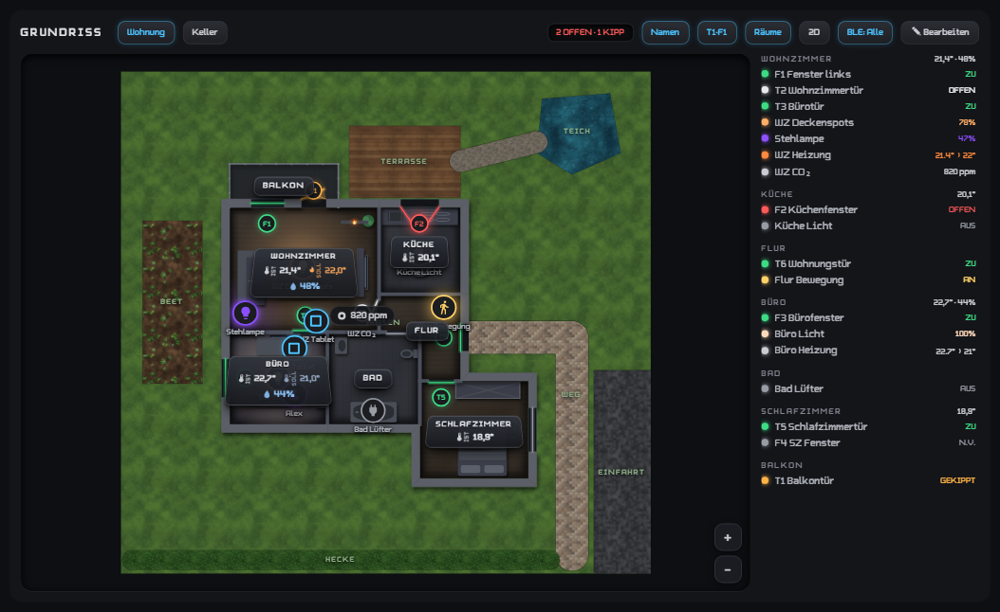
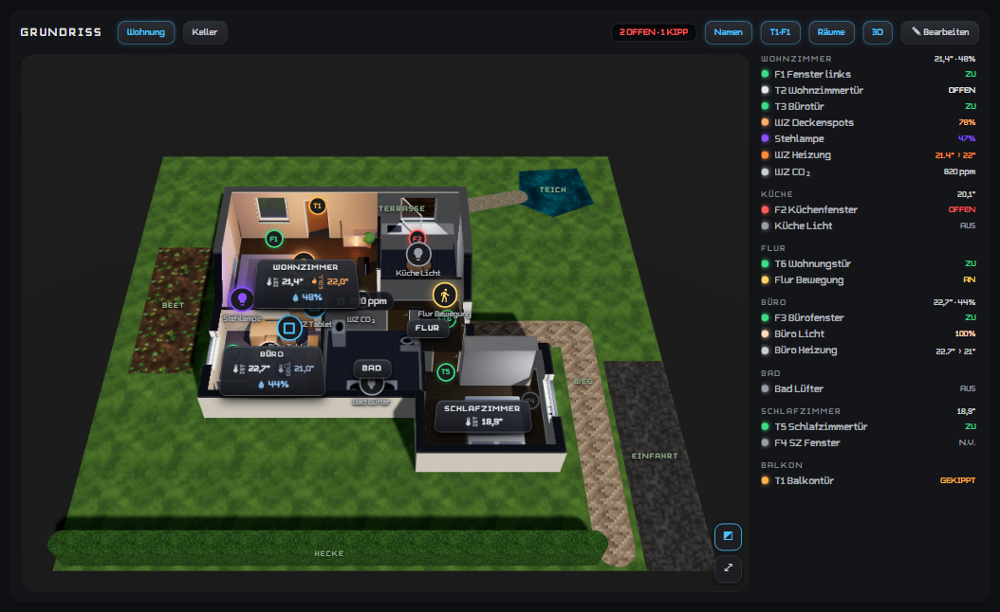
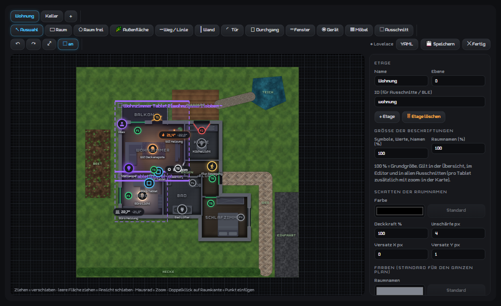

# Floor Plan Card (Home Twin)



*Rendered from the card code with example data (no real Home Assistant). Sample apartment.*

<details><summary>More screenshots</summary>

**3D view**



**Built-in editor**



</details>

A central, editable floor plan of your home for Home Assistant – a "digital twin" in 2D and 3D.
Draw floors, rooms, walls, windows/doors, outdoor areas and furniture in the built-in editor, place devices
(lights, switches, thermostats, sensors, motion detectors, BLE positions) and show live states. Wall tablets
show named **cut-outs** of the same plan, so a change to the plan applies everywhere at once.

- Card types: `custom:home-twin-card` and `custom:haus-grundriss` (same card, old name kept for compatibility)
- Version: 2.33.1-beta.1 (3D module `home-twin-3d.js` 2.10.0-beta.1)
- UI language: German (English translation not yet available). Option names are German and kept for compatibility.

> Built for the author's own home. All coordinates are in meters (x to the right, y down).

## Features

- Editor (admins): rooms as rectangles or polygons, automatic inner/outer walls from room edges, free walls,
  per-wall thickness/height, doors and windows on walls, outdoor areas (lawn, garden, hedge, deck, paving,
  gravel, water, asphalt) and paths, furniture symbols, own images and own 3D models, undo/redo, snapping grid,
  multiple floors.
- Devices on the plan: light (with light cone in the light color), switch, thermostat (current › target,
  flame while heating), sensor values, detectors, BLE position (entity attributes `x`, `y`, `floor`).
- Window/door states (open/tilted/closed), pulsing when open while the alarm is armed or heating is on.
- Realistic 2D rendering (soft wall shadows, textures) or classic flat style.
- 3D view (three.js, bundled locally – works offline): walls, openings, doors, furniture, lights as real light
  sources, daylight from `sun.sun`, orbit controls; optional apartment-building context (neighbor units,
  stairwell, roofs).
- Rooms linked to Home Assistant areas: tap a room name to see and control the area's devices.
- Named cut-outs (`ausschnitt:`) for room tablets, `modus: fenster` for a house-wide windows/doors overview
  with light/motion/heating/person layers.
- Plan storage in the [home_twin_ha_integration](https://github.com/SysriX/home_twin_ha_integration)
  (database with revisions and live updates). Without the integration the plan is read from / saved to the
  Lovelace dashboard `haus-grundriss` (master card with `plan:`).
- Parts can be arranged freely inside [room_panel_ha_card](https://github.com/SysriX/room_panel_ha_card)
  (`rp-extcard` bridge, `teil:`), and the panel's `floorplan` module embeds cut-outs.

## Requirements

- Home Assistant 2024.1 or newer.
- Recommended: [home_twin_ha_integration](https://github.com/SysriX/home_twin_ha_integration) (plan database,
  BLE positions). Optional: [room_panel_ha_card](https://github.com/SysriX/room_panel_ha_card).

## Installation

### HACS (custom repository)

1. HACS → ⋮ → **Custom repositories** → add `https://github.com/SysriX/floor_plan_ha_card`, category **Dashboard**.
2. Install **Floor Plan Card (Home Twin)**.
3. The resource is `/hacsfiles/floor_plan_ha_card/floor_plan_ha_card.js` (type *JavaScript module*).
   Only this file is registered; `home-twin-3d.js` and `vendor/` are loaded on demand from the same folder.

### Manual

Copy the whole `dist/` folder content (`floor_plan_ha_card.js`, `home-twin-3d.js`, `vendor/`) into one folder,
e.g. `/config/www/raum-tablet-card/`, and add the resource `/local/raum-tablet-card/floor_plan_ha_card.js`
(type *JavaScript module*). The script locates the 3D module next to itself (the old file name
`haus-grundriss.js` is still recognized).

## Configuration

Master card (whole plan, with editor):

```yaml
type: custom:home-twin-card
# plan_id: main          # plan in the home_twin integration (default main)
# twin: false            # force the old Lovelace storage
# etage: basement        # show one floor
# labels: true
# legend: true
# height: 500px
```

Cut-out on a room tablet:

```yaml
type: custom:home-twin-card
ausschnitt: office       # ID of a cut-out drawn in the editor
# quelle: haus-grundriss # dashboard holding the plan (fallback without integration)
# ansicht: 3d            # 3D instead of 2D
# stil: klassisch        # flat 2D style
# neigung: 30            # 3D camera tilt in degrees
# rund: 14 / rahmen: 3 / schatten: true   # corner radius, frame, shadow
```

Windows/doors overview for a hallway tablet:

```yaml
type: custom:home-twin-card
modus: fenster
etagen: alle
alarm_entity: alarm_control_panel.home_alarm
# ebenen: [licht, bewegung]                  # layers on at start: licht, bewegung, heizung, werte, ble
# ebenen_schalter: [licht, bewegung, heizung, ble]
```

Further 3D options: `wandhoehe`, `schatten3d: false`, `bewegen3d: false`, `tageslicht: false`, `knopf3d: false`,
`gebaeude: wohnung|etage|haus`, `raum_tippen: true|false`.

## User data folders

Not part of this repository – create them yourself if you use the feature:

| Path | Used for |
|---|---|
| `/config/www/grundriss/` → `/local/grundriss/<file>.png` | own furniture/plan images (PNG/JPG/SVG; small files can also be uploaded in the editor) |
| `/config/www/grundriss/moebel/` → `/local/grundriss/moebel/<model>.dae` | own 3D furniture models (COLLADA `.dae` from SketchUp with its texture folder, or `.glb`/`.gltf`) |

## Licenses

- Code: MIT License, see [LICENSE](LICENSE).
- `dist/vendor/`: [three.js](https://threejs.org/) and its loaders/controls, MIT License (see `dist/vendor/three-LICENSE.txt`).
